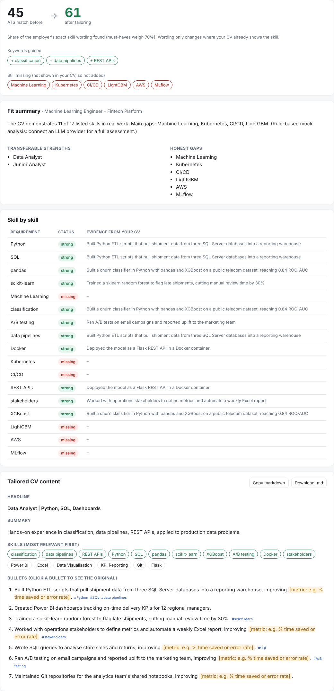
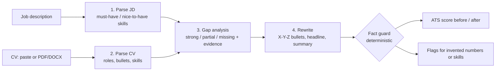

# CV Tailor Agent

**An LLM workflow that tailors a CV to a job description and refuses to make things up.**

It reads a job posting and a CV, assesses fit skill by skill, rewrites bullets in Google's
X-Y-Z format ("accomplished X, as measured by Y, by doing Z"), and scores ATS keyword
coverage before and after. A deterministic **fact guard** then checks every rewritten line
against the original CV (bullets, headline, summary and skills) and flags any number or skill the model added.


 




---

## Why I built it

Most "AI CV writers" make CVs sound better by inventing results. A fabricated metric can cost a
candidate the job at interview. I wanted a tool that helps a CV get past keyword filters and
reads well to a hiring manager, while keeping every claim checkable. So the LLM does the language
work, and plain Python checks the facts.

## How it works



| Step | What happens | Who does it |
|---|---|---|
| 1-2 | JD and CV are turned into typed JSON (Pydantic models). These two calls run **in parallel**. | LLM |
| 3 | Each requirement is marked strong / partial / missing, with a quote from the CV as evidence | LLM |
| 4 | Bullets are rewritten in X-Y-Z form. Where there's no result, a `[metric: …]` placeholder is left for you to fill instead of a made-up number | LLM |
| ✓ | **Fact guard:** any number or skill in the output that's missing from the original CV is flagged, and unsupported skills are removed from the skills list | Python |
| ✓ | **ATS score:** literal match of the employer's exact skill wording, must-haves weighted 70%. The job title is excluded, so echoing it can't inflate the score | Python |

### Design decisions

- **Two matching modes.** ATS systems match words literally, so the score uses the employer's exact
  phrase. The fact guard is alias-aware: if your CV says "sklearn", the tool may write
  "scikit-learn", the employer's wording. It won't add Kubernetes if you've never mentioned it.
- **Related products aren't the same skill.** Specific products imply their family but not each other:
  "SQL Server" proves SQL, but not PostgreSQL; "S3" proves AWS, but "AWS" doesn't prove SageMaker.
- **Keywords are computed, not left to the model.** Between steps 3 and 4, code works out which employer
  phrases are missing word-for-word but supported by the CV (alias match, or a gap-analysis quote that is
  verified to really appear in the CV). The rewrite must use those verbatim. A skill "justified" by a
  quote that isn't in the CV is rejected.
- **Structured output with self-repair.** Every LLM step must return JSON that validates against a
  Pydantic schema. If it doesn't, the validation error is sent back to the model once to fix
  (`app/llm/base.py`).
- **Provider-agnostic.** Anthropic and OpenAI sit behind one small interface, chosen with an
  environment variable. A rule-based **mock provider** makes the whole app, the tests and CI run
  with no API key and no cost.
- **Privacy.** CVs are processed in memory and never stored. Nothing is logged except timings and counts.

## Master CV workflow (getting to a high score honestly)

A one-page CV can't list everything you've done, so jobs asking for skills you have but didn't
fit on the page score low. The fix is a **master CV**: one long, private, truthful document.

1. Paste your longest CV and click **Save as master CV**. It's stored in `my_cv/master_cv.md`,
   which is git-ignored and never leaves your machine.
2. For each job, click **Use master CV**, paste the posting and tailor. The rewrite picks the most
   relevant bullets from any role or project.
3. Under **Still missing**, click a skill you really have and add one sentence of evidence. It's
   appended to the master CV under *Confirmed skills* and counts from the next run onwards.

Each job you apply to makes the master CV more complete. Skills you don't have stay missing:
that list is your learning plan, or a sign the job isn't a fit.

Set `MASTER_CV_ENABLED=false` if you ever deploy the app for other people.

## Quick start

```bash
git clone https://github.com/mohammadsharvankk/cv-tailor-agent.git
cd cv-tailor-agent
python -m venv venv && source venv/bin/activate      # Windows: venv\Scripts\activate
pip install -r requirements.txt

cp .env.example .env        # Windows: copy .env.example .env
# edit .env: set LLM_PROVIDER=anthropic (or openai) and paste your API key
uvicorn app.main:app --reload
```

Open http://localhost:8000, click **Load sample**, then **Tailor my CV**.
With `LLM_PROVIDER=mock` it runs without any key, using basic rule-based output.

### With Docker

```bash
docker build -t cv-tailor-agent .
docker run -p 8000:8000 --env-file .env cv-tailor-agent
```

## API

Interactive docs at `/docs` (OpenAPI / Swagger).

| Method | Path | Body | Returns |
|---|---|---|---|
| `GET` | `/api/health` | – | provider in use |
| `POST` | `/api/extract` | multipart file (`.pdf`, `.docx`, `.txt`, `.md`, ≤ 5 MB) | `{ "text": … }` |
| `GET` / `PUT` | `/api/master` | `{ "text": … }` on PUT | your private master CV |
| `POST` | `/api/master/evidence` | `{ "skill": …, "evidence": … }` | master CV with the new confirmed skill |
| `POST` | `/api/analyze` | `{ "cv_text": …, "jd_text": … }` | job, CV, gaps, tailored CV, ATS before/after, fact flags, markdown |

```bash
curl -s localhost:8000/api/analyze -H "Content-Type: application/json" \
  -d "{\"cv_text\": \"$(cat app/static/samples/sample_cv.txt)\", \"jd_text\": \"$(cat app/static/samples/sample_jd.txt)\"}"
```

## Project layout

```
app/
  main.py              FastAPI routes + static UI
  config.py            settings from env / .env
  models.py            Pydantic contracts for every step
  extract.py           PDF / DOCX / TXT -> text
  master.py            private master CV: load, save, add confirmed skills
  llm/
    base.py            provider interface, JSON extraction, validate-and-repair loop
    providers.py       Anthropic + OpenAI providers and factory
    mock.py            rule-based provider for tests and offline demo
  pipeline/
    tailor.py          the 4-step workflow (steps 1-2 in parallel)
    prompts.py         system prompts with hard anti-fabrication rules
    checks.py          ATS score, fact guard, markdown rendering
    skills.py          ~100 skills with aliases; literal vs alias-aware matching
  static/              single-page UI (HTML/CSS/vanilla JS) + sample CV and JD
tests/                 22 pytest tests: checks, LLM retry logic, API end to end
```

## Testing

```bash
pip install -r requirements-dev.txt
pytest -q          # runs on the mock provider, so no API calls
ruff check app tests
```

GitHub Actions runs lint, tests and a Docker build on every push.

## Limitations and next steps

- The ATS score is a transparent approximation. Real ATS products differ and don't publish their rules.
- The skill vocabulary drives the fact guard. A skill outside it can't be flagged, so the LLM's own
  rules are the backstop there.
- Ideas: export to DOCX in a clean ATS template, cover-letter drafting with the same fact guard,
  and an evaluation set of CV/JD pairs to measure flag rates per model.

The sample CV (`Alex Morgan`) and job posting are fictional.

## Licence

MIT, see `LICENSE`.
